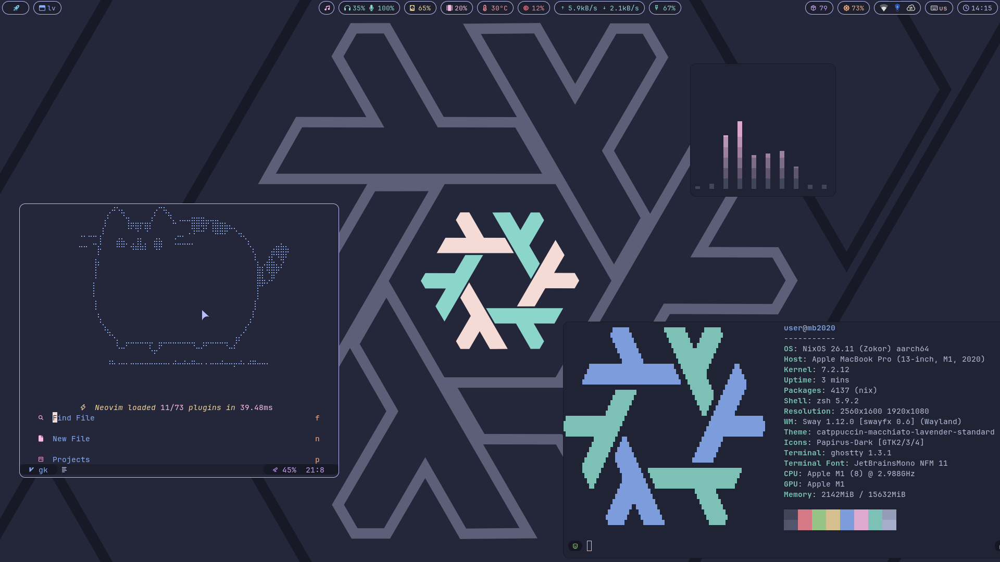

# dotfiles



NixOS dotfiles for my Apple silicon Macbook 💻

**Desktop:**

- Sway + waybar + rofi desktop
- Catppuccin Macchiato everywhere
- LazyVim setup

**System:**

- LUKS + btrfs with automatic snapshots
- Asahi Linux kernel
- security hardening
- custom user filesystem: `.bin, .cfg, etc, dev, med, doc, tmp`

## Structure

```
.
├── flake.nix        # inputs
├── hosts/
│   ├── mb2017/      # boot, hardware, disko
│   └── mb2020/      # boot, hardware, touchbar
├── modules/         # system configs
├── home/            # home-manager configs
├── pkgs/            # custom packages
│   ├── awecron/
│   └── ...
├── extra/           # raw configs
│   ├── nvim/        # LazyVim
│   ├── lf/
│   ├── bin/         # scripts symlinked to ~/.bin
│   ├── awecron/     # cron jobs
│   └── ...
└── wallpapers/
```

## Usage

### Rebuild

```sh
doas nixos-rebuild switch --impure --flake .#mb2020
```

`--impure` is required by nixos-apple-silicon because of `/boot/vendorfw`

### Update

```sh
nix flake update nixpkgs home-manager catppuccin disko   # general
nix flake update apple-silicon                           # kernel only
```

### Install mb2020

1. Follow the [nixos-apple-silicon](https://github.com/nix-community/nixos-apple-silicon/blob/main/docs/uefi-standalone.md) guide to install m1n1 + U-Boot and boot the NixOS installer
2. Partition manually: ESP + one LUKS partition. Inside LUKS, btrfs with subvolumes `root`, `home`, `snapshots`, `swap`, `opt`. Disko is not used on this host
3. Update the UUIDs in `hosts/mb2020/boot.nix` and `hosts/mb2020/hardware.nix`
4. `nixos-install --impure --flake .#mb2020`

### Install mb2017

1. Set the target disk in `hosts/mb2017/disko.nix`
2. `nix run github:nix-community/disko -- --mode destroy,format,mount ./hosts/mb2017/disko.nix`
3. `nixos-generate-config --no-filesystems --root /mnt` and merge kernel modules into `hosts/mb2017/hardware.nix`
4. `nixos-install --impure --flake .#mb2017`
